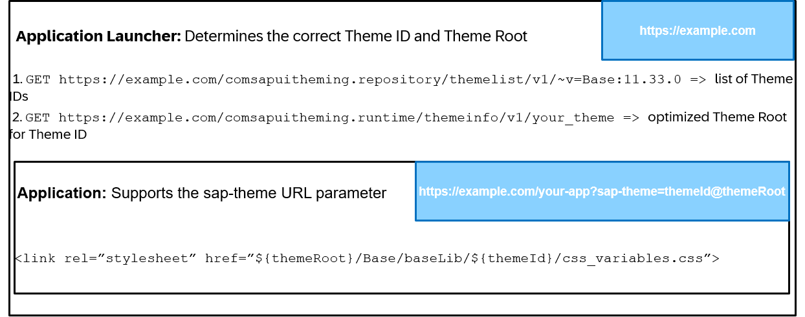

<!-- loio4415dd39d3a046bbbdf2e5d6ed6f5692 -->

# Developing Themеable Applications

There are two main aspects in developing themеable applications:

### Determining the correct Theme ID and Theme Root to use

This is usually covered by SAP Build Work Zone. You have to do that manually, if you launch applications outside the SAP Build Work Zone shell. [Determining Theme ID and Theme Root](determining-theme-id-and-theme-root-c612d38.md) describes the necessary steps in detail.

In short, you request the list of theme IDs from the repository endpoint of the UI Theme Designer service \(from the `/themeroot/v1` API\), and information about the desired theme, including its optimized theme root, from the runtime endpoint \(from the `/themeinfo/v1` API\). If you host your theme yourselves, without interacting with the UI Theme Designer service, you use your hosted URL as the theme root. This is described in [Self-Hosting Themes for Use Without the UI Theme Designer Service](self-hosting-themes-for-use-without-the-ui-theme-designer-service-80f0904.md).

### Supporting the sap-theme URL parameter

This is usually covered by UI technologies like UI5 Web Components or SAPUI5. You have to do that manually, if you do not use such a UI technology. [Supporting the sap-theme URL Parameter](supporting-the-sap-theme-url-parameter-ab10b7d.md) goes into detail on that topic. In essence, you split the sap-theme parameter at the `@`, use the 1st part as theme ID and the 2nd as theme root, and load `${themeRoot}/Base/baseLib/${themeId}/css_variables.css`.

The following diagram gives a visual example on the high-level steps necessary:

